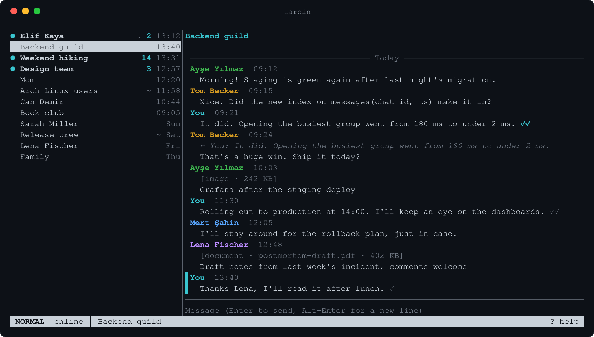

# tarcin

**A fast, private terminal client for WhatsApp, built for Arch Linux.**

[](https://github.com/Yaman-yagiz/tarcin/actions/workflows/ci.yml)
[](LICENSE)
[](go.mod)
[](docs/terminals.md)

tarcin is a keyboard-driven WhatsApp client for people who live in the
terminal and belong to large, busy groups. The interface never waits on
the network, the disk or the size of a group: scrolling, typing and
switching chats stay instant in a group of thousands of members and
hundreds of thousands of messages.



> [!WARNING]
> tarcin is an **unofficial** client and is not affiliated with,
> endorsed by or sponsored by WhatsApp or Meta. WhatsApp's
> [Terms of Service](https://www.whatsapp.com/legal/terms-of-service)
> do not allow unofficial clients, and an account that uses one can be
> restricted or banned. Use it at your own risk; see the
> [FAQ](docs/user/faq.md#is-my-account-at-risk).

## Features

- **Linking** as a companion device, by QR code, pairing code or passkey
- **Messaging**: text, replies, reactions, mentions, edits, deleting for
  everyone and forwarding, sent in order with delivery and read ticks
- **Media**: open attachments in your own programs, save them, and send
  files with `:attach`
- **History** stored as it arrives from your phone; older messages are
  fetched on demand as you scroll back
- **Search** across every chat, ignoring case and accents, and
  Turkish-aware (`kadin` finds `Kadın`)
- **Chats**: unread counts, pinned, muted and archived chats synced with
  your phone, disappearing messages, group member lists
- **Privacy settings** for read receipts, typing indicators and online
  status; tarcin is online only while you are active
- **Desktop notifications** over D-Bus that respect focus and muted chats
- **Comfortable**: vim-style keys that you can rebind, `$EDITOR` compose,
  a high-contrast theme, `NO_COLOR`, man pages and shell completions
- **Several accounts**, kept apart with `--profile`

Voice and video calls, statuses and payments are out of scope, and so
are bulk messaging, scheduling, bots and scraping.

## Performance

Responsiveness is a release requirement, not an aim. Each budget is
checked with a reproducible benchmark (`make storagebench`,
`make loadtest`) on a generated account of 1,000 chats and 100,000
messages, with a 10,000-message group of 5,000 members:

| Measurement | Budget (p95) | Measured |
|---|---|---|
| Start until the chat list is drawn | ≤ 300 ms | about 100 ms |
| Open a 10,000-message chat | ≤ 50 ms | 0.9 ms |
| Key press to frame, while 100 messages/s arrive | ≤ 33 ms | 22 ms |
| History import | ≥ 5,000 msg/s | 16,500 msg/s |
| Memory with that group open | ≤ 150 MB | 30 MB |

See [performance](docs/architecture/performance.md) for every budget and
how it is measured.

## Installation

tarcin runs on Linux. Arch Linux is the primary target.

### From the AUR

The `tarcin` and `tarcin-git` packages will be published with the first
release:

```sh
yay -S tarcin
```

### From source

Building needs Go 1.26 or newer, a C compiler (SQLite is linked through
cgo) and `scdoc` for the man pages:

```sh
sudo pacman -S --needed go base-devel git scdoc
git clone https://github.com/Yaman-yagiz/tarcin.git
cd tarcin
make                           # ./build: binary, man pages, example config
sudo make install PREFIX=/usr  # copy them, the completions and the desktop file into place
```

See the [install guide](docs/user/install.md) for details.

## Getting started

```sh
tarcin           # link this device, then open your chats
tarcin --demo    # try the interface on simulated chats, no account needed
tarcin logout    # unlink the device and delete its keys
```

On the first run tarcin explains the account risk and how your data is
stored, and links only once you press Enter. Then link it from your
phone under *Settings → Linked devices*.

`tab` moves between the chat list, the open chat and the composer, `?`
shows every key and command, and `ctrl+q` quits. The
[quick start](docs/user/quick-start.md) covers the rest.

## Configuration

Settings live in `~/.config/tarcin/config.toml`: privacy settings, the
theme, programs for media, notifications, the log level and every key
binding. `tarcin config print-defaults` prints a commented file with the
defaults, and `tarcin config check` validates yours. See
[configuration](docs/user/configuration.md) and `man 5 tarcin`.

## Your data

Messages and the device's keys stay on your computer, in
`~/.local/share/tarcin`, readable only by you. **tarcin does not encrypt
them itself, so use full-disk encryption** (for example LUKS).
`tarcin backup FILE` saves your messages without the keys. There is no
telemetry, and the log never contains message content, names or phone
numbers. See [data and privacy](docs/user/data.md).

## Documentation

| | |
|---|---|
| [User guide](docs/user/README.md) | Install, link, use and configure tarcin |
| [Architecture](docs/architecture/overview.md) | How tarcin is built |
| [Decisions](docs/adr/README.md) | Why it is built that way |
| [Security](docs/architecture/security.md) | Threat model and controls |
| [Changelog](CHANGELOG.md) | What changed in each release |

## Project status

tarcin is in early development. It runs on a real account and every
planned 1.0 feature is in place, but there is no tagged release yet.
Expect rough edges, and try it on an account you can afford to lose.

## Contributing

Contributions are welcome. See [CONTRIBUTING.md](CONTRIBUTING.md) and the
[code of conduct](CODE_OF_CONDUCT.md). To report a security issue, follow
[SECURITY.md](SECURITY.md) and do not open a public issue.

## License

Copyright © 2026 tarcin contributors.

tarcin is free software, licensed under the
[GNU General Public License v3.0 or later](LICENSE). It uses
[whatsmeow](https://github.com/tulir/whatsmeow), licensed under the
Mozilla Public License 2.0.

"WhatsApp" is a trademark of WhatsApp LLC. It is used here only to
describe compatibility.
